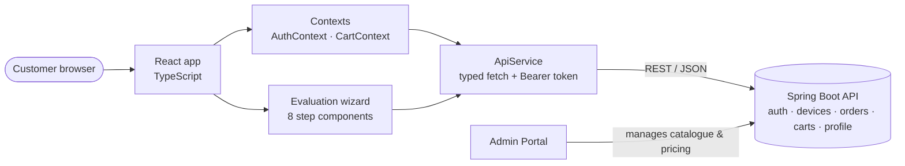

# DigiCashOn – Client Portal (React)

The customer-facing web app for **DigiCashOn**, a platform where customers **sell used devices** (laptops, mobiles, tablets) for an instant price quote and **book laptop and mobile repair services**. It is built with **React 18**, **TypeScript** and **Tailwind CSS**, and talks to a **Spring Boot REST backend** that is shared with the DigiCashOn Admin Portal.


---

## Highlights

- **Multi-step device evaluation wizard** that calculates a resale price from the device's configuration, condition and age, using pricing rules served by the backend
- **Dynamic catalogue routing**: `/sell/[superCategory]/[brand]/[model]` pages are driven by data the admin team manages in the Admin Portal
- **Complete customer journey**: OTP sign-up and login, cart, checkout, order history, address book, and invoice PDF download
- **Typed API layer**: a single `ApiService` class with Bearer-token handling and typed request/response models for ~50 backend endpoints
- **Lead capture**: in-progress valuations are saved as *temp leads*, so the business can follow up with customers who drop off
- **Responsive UI** built with Tailwind, with a floating WhatsApp contact button and browser geolocation to pre-fill the customer's city

---

## Features

### Sell a device
1. Choose a category, then a brand, then a model (all loaded from the backend)
2. A guided evaluation wizard:

   | Step | What the customer provides |
   |------|----------------------------|
   | Initial price | Base quote for the selected model |
   | Power status | Does the device switch on? |
   | System configuration | Processor, RAM, storage, graphics card, screen size |
   | Functional issues | Battery, keyboard, ports, Wi-Fi, webcam, speakers … (icon-based) |
   | Accessories | Original box and packaging, invoice |
   | Device age | Age bracket → depreciation |
   | Physical condition | Screen and body condition multipliers |
   | Final summary | Calculated price, then the customer accepts or rejects the offer |

3. The customer accepts the offer and places a pickup order to an address from their address book

### Repair services
- Laptop and mobile repair service catalogue with filtering
- Service **cart**: add, remove, change quantity, see a summary, place the order

### Account
- Sign-up with **mobile OTP verification**, then login by password or OTP
- Forgot and reset password, and change password with a strength check
- Profile details and an **address book** (add, edit, delete, set default)
- **Order history** for sell and repair orders, with order details, cancellation, and **PDF invoice** generation (jsPDF)

---

## Architecture



### Project structure

```
src
├── app                              # pages and routing
│   ├── page.tsx                     # home: hero slider, sell & repair entry points
│   ├── sell/[superCategory]/[brand]/[model]   # dynamic sell flow
│   ├── sell-product/                # device type selection
│   ├── repair/laptop · repair/mobile
│   └── profile/                     # account area
├── components
│   ├── device-evaluation/           # 8-step price evaluation wizard
│   ├── profile/                     # orders, addresses, billing, password
│   ├── Header · Footer · LoginModal · AddressSelectionModal · …
├── contexts                         # AuthContext, CartContext
├── services/api.ts                  # ApiService – all backend calls
├── hooks                            # useClientOnly (SSR-safe rendering)
└── types                            # address, laptop, orders, service-categories
```

### Backend API used

| Area             | Example endpoints |
|------------------|-------------------|
| Auth & OTP       | `POST /auth/login`, `/auth/login/send-otp`, `/auth/signup/verify-otp`, `/auth/reset-password` |
| Device catalogue | `GET /devices/config/super-categories`, `/processors`, `/ram-options`, `/functional-issues` |
| Evaluation       | `POST /devices/evaluations/calculate`, `/evaluations/{id}/approve`, `/reject`, `POST /devices/temp-leads` |
| Orders           | `POST /orders/create`, `GET /orders/my-orders`, `/orders/details/{orderNumber}` |
| Service cart     | `/service-carts/items`, `/service-carts/summary`, `/service-carts/place-order` |
| Profile          | `/users/profile/details`, `/profile/addresses` |

---

## Tech stack

| Concern    | Choice |
|------------|--------|
| Framework  | React 18 (Next.js 13 for routing and build) |
| Language   | TypeScript 5 |
| Styling    | Tailwind CSS 3, PostCSS |
| PDFs       | jsPDF |
| Quality    | ESLint (`eslint-config-next`) |
| Backend    | Spring Boot REST API (separate repository) |

---

## Getting started

### Prerequisites
- Node.js 18+
- The DigiCashOn backend running locally or remotely

### Setup

```bash
npm install
```

Create a `.env.local` file in the project root (it is git-ignored):

```bash
NEXT_PUBLIC_API_BASE_URL=http://localhost:8080/api
```

If you don't set it, the app uses `http://localhost:8080/api`.

### Run

```bash
npm run dev      # http://localhost:3000
npm run build    # production build
npm start        # serve the production build
```

---

## Branches

| Branch        | Purpose |
|---------------|---------|
| `main`        | Latest code (default) |
| `dev`         | Development snapshot |
| `prod`        | Production snapshot |
| `main-backup` | Backup snapshot of `main` |

---

## Roadmap

- Move the auth token from `localStorage` to HTTP-only cookies
- Data fetching and caching with React Query / SWR
- Form validation with React Hook Form + Zod
- Unit tests (Jest + React Testing Library) and end-to-end tests (Playwright)
- Online payments and live order tracking
- Upgrade to the latest React version

---

## Author

**Alam** – Java full-stack developer (Java / Spring Boot, React) with 10+ years of experience
GitHub: [@alamsoftware68](https://github.com/alamsoftware68)
